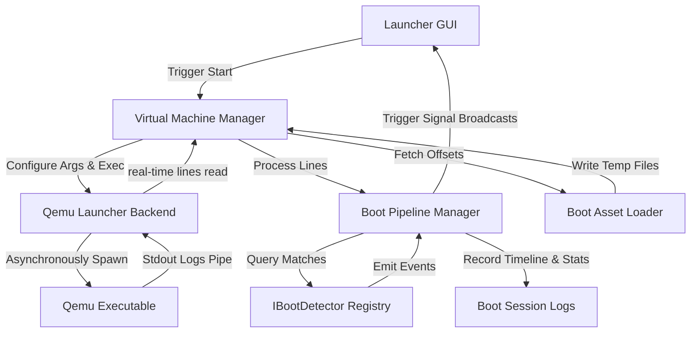

# Emulator Architecture

This document describes the high-level architecture of the **CustomAndroidEmulator** system. The emulator is built as a highly modular, decoupled set of static C++ libraries connected to a Qt6-based GUI launcher application.

---

## 1. System Block Diagram

---

## 2. Design Principles

### Decoupled Subsystems
No library depends directly on the UI (`launcher`). Libraries communicate via standard parameters, structs defined in the common `models` package, or asynchronously using Qt's Signal/Slot mechanism.

### Authoritative boot.img Source
Instead of permanently extracting partition images or writing redundant files, the project retains `boot.img` intact. Bytes are sought in-memory using recorded file offsets and temporary physical files are only spawned in a safe cache directory (`_tmp_boot/`) while QEMU executes.

### Event-Driven Pipeline
The log parsing pipeline is divided into independent log matchers (detectors) registering under a registry sorted by priority integers. They scan console logs and dispatch structured events, keeping the boot state machine generic and easily extensible.
