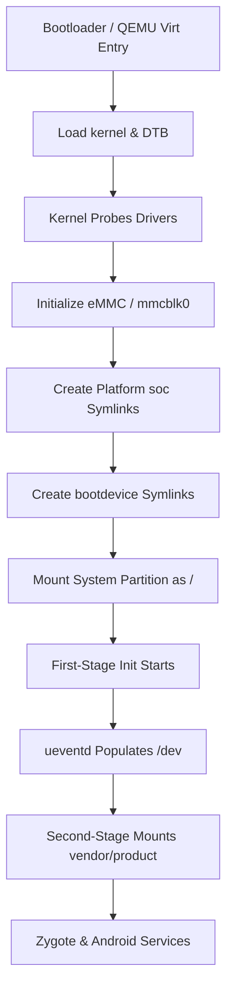

# Expected Boot Chain Reference

**ROM:** PixelExperience_violet-13.0-20240127-0711-OFFICIAL  
**Device:** Xiaomi Redmi Note 7 Pro (violet) — Snapdragon 675, eMMC storage  
**Updated:** Phase 6.2 (ongoing)

---

## Chronological Boot Sequence

This document describes the native Android boot sequence expected by the reference ROM on real hardware, contrasted with the emulator's current capability.

### 1. Bootloader Stage
On real hardware, the Qualcomm primary/secondary bootloaders (XBL/ABL) set up the hardware, specify `ro.boot.bootdevice` based on the detected hardware (e.g. `7c4000.sdhci`), and load the `boot.img` (kernel + device tree).
- **QEMU Emulation:** QEMU directly enters the kernel (`-kernel`) with a generic DTB built for the `virt` board.

### 2. Device Tree Parsing (CONFIG_OF)
The kernel initializes memory, CPU, interrupt controller, and clocks using the flattened Device Tree blob (DTB).
- **SoC Requirement:** The DTB must describe the Snapdragon 675 (SM6150) platform hardware.
- **Current Blocker:** The `virt` DTB does not match, so Snapdragon-specific platform drivers do not probe.

### 3. Storage Driver Initialization (CONFIG_MMC_SDHCI_MSM)
The built-in Qualcomm platform SDHCI host driver probes `7c4000.sdhci` mapped at the SoC MMIO address `0x07c4000`. Once active, it registers the block device `mmcblk0`.
- **Current Blocker:** QEMU does not expose any storage host at `0x07c4000`, so no `mmcblk0` is created.

### 4. Partitions Symlinking (First-Stage Init)
The Linux kernel mounts the root filesystem. Since `ramdisk_size=0` in the boot image, the kernel expects a System-As-Root configuration and mounts the system partition directly.
The early init script:
1. Probes the boot block device.
2. Resolves `ro.boot.bootdevice` (which evaluates to `7c4000.sdhci`).
3. Creates symlink `/dev/block/bootdevice` pointing to `/dev/block/platform/soc/7c4000.sdhci`.
4. This enables mounting partitions via path-independent by-name links (e.g. `/dev/block/bootdevice/by-name/system` ➔ `/`).

### 5. First-Stage `/init` Execution
The kernel executes `/init` from the mounted root directory. First-stage init:
1. Mounts temporary filesystems (`/sys`, `/proc`, `/dev`, `/metadata`).
2. Starts `ueventd` to parse rules (`ueventd.rc`) and dynamically populate device nodes under `/dev` (since `CONFIG_DEVTMPFS` is not set).

### 6. Second-Stage Mounts (fstab)
Init parses properties, parses `fstab.qcom`, and mounts vendor/product/metadata/userdata partitions.
- `/vendor` maps to `/dev/block/bootdevice/by-name/vendor`
- `/data` maps to `/dev/block/bootdevice/by-name/userdata`

### 7. Zygote & Android Userspace
The core Android daemon framework starts, mounting APEX packages, launching system services, and starting Zygote/System Server.

---

## Key Open Design Questions

1. **Can the kernel boot with a different Device Tree?**
   - **DTB Compatibility:** If the kernel is strictly bound to Qualcomm SM6150 DTB parameters, booting with QEMU's generic `virt` DTB will fail at early CPU/MMU setup. We must verify if the guest kernel successfully initializes CPU, clocks, and basic serial console when given QEMU's `virt` DTB.
2. **What platform storage is visible to the guest?**
   - Since VirtIO is missing, we must map what platform block interfaces are available in QEMU's `virt` machine that the guest kernel config can support (e.g. loops, ramdisks, standard SD controllers).
